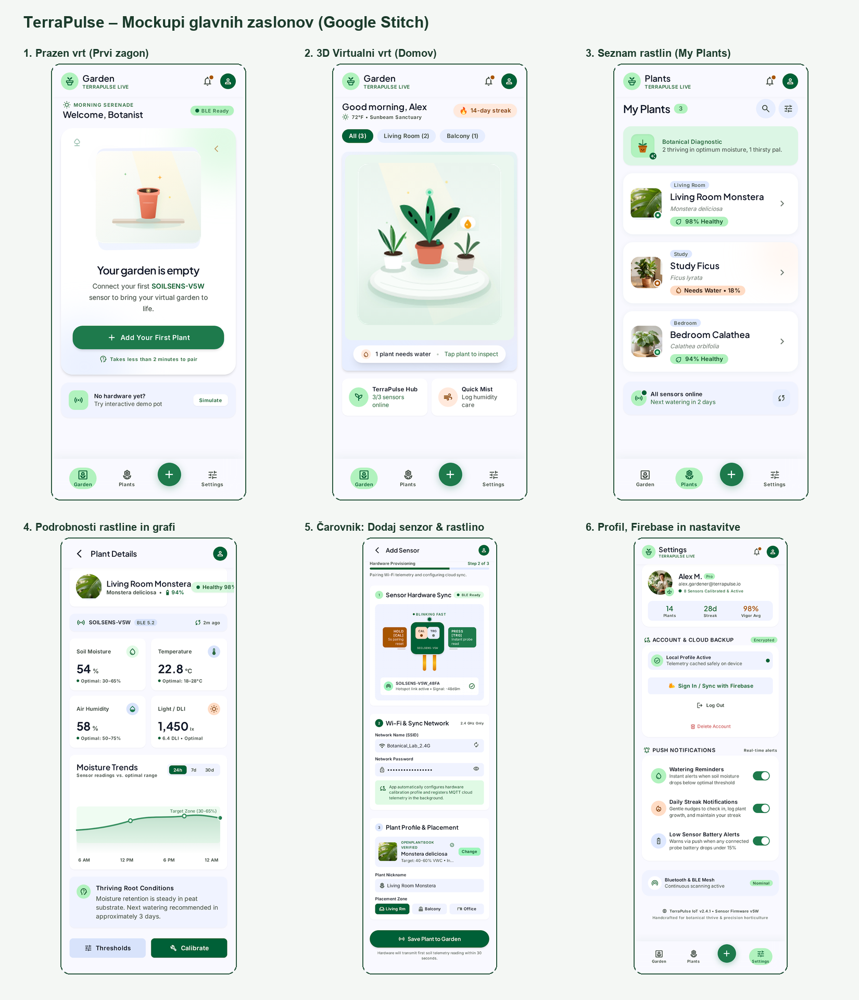
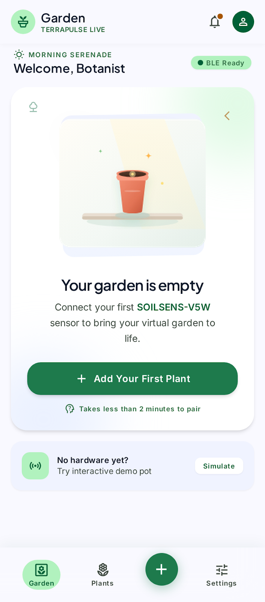
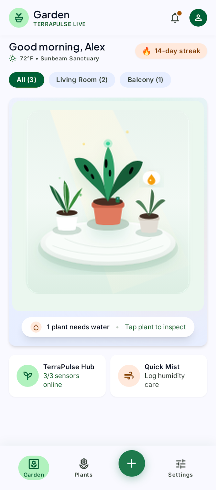
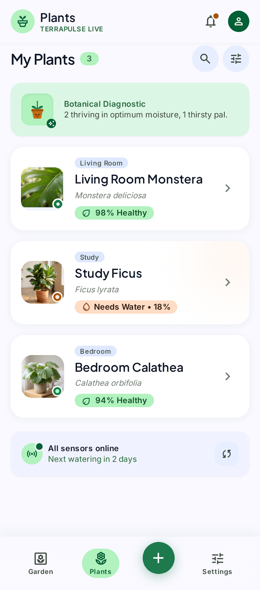
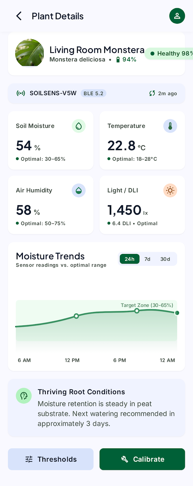
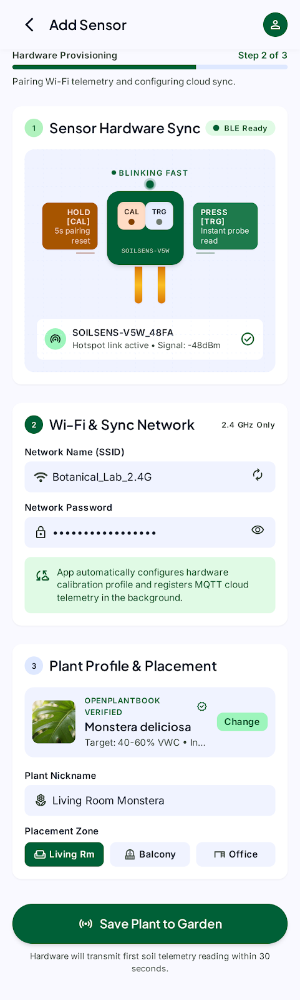
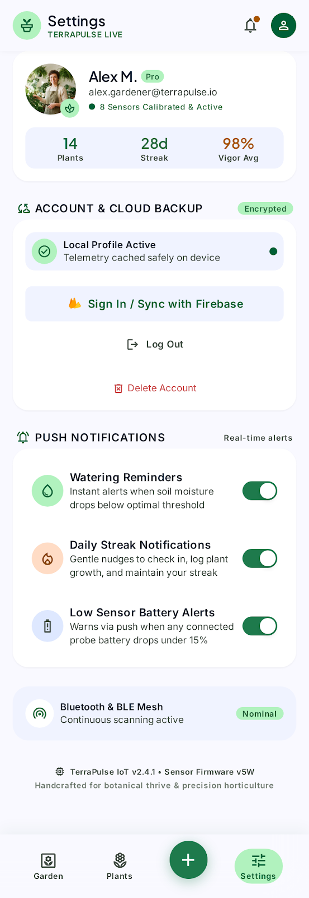

# 3. Mockupi/prototipi najpomembnejših zaslonov in predvidena navigacija

## 3.1 Skupni pregled mockupov (Google Stitch – Botanical Precision)

Spodnja slika prikazuje vseh šest ključnih zaslonov mobilne aplikacije **TerraPulse**, zasnovanih z minimalističnim, zračnim in preglednim vmesnikom (brez prenasičenosti s podatki):



---

## 3.2 Podroben opis posameznih zaslonov

### Zaslon 1: Prazen vrt ob prvem zagonu (*Empty Garden State*)
* **Kdaj se prikaže:** Ko uporabnik prvič odpre aplikacijo in še nima dodane nobene rastline oz. senzorja.
* **Glavni elementi:**
  * Minimalistična ilustracija praznega lončka na obsijani okenski polici.
  * Kratko in jasno sporočilo (*"Your garden is empty – Connect your first SOILSENS-V5W sensor to bring your virtual garden to life"*).
  * Glavni akcijski gumb **`+ Add Your First Plant`**, ki uporabnika neposredno pelje v vodeni čarovnik za dodajanje prve rastline in senzorja, ter možnost preizkusa interaktivnega demo lončka (*Simulate*).

| Zaslon 1: Prazen vrt (*Empty Garden*) | Zaslon 2: 3D Ambientni virtualni vrt (*Virtual Garden*) |
| :---: | :---: |
|  |  |

---

### Zaslon 2: 3D Ambientni virtualni vrt (*Virtual Garden – Home*)
* **Kdaj se prikaže:** Privzeti začetni zaslon (`Garden`), ko ima uporabnik dodano vsaj eno rastlino.
* **Glavni elementi:**
  * **Kompaktna pasica dnevnega niza (*Streak Badge*):** V zgornjem desnem kotu prikazuje trenutni niz zaporednih dni zdravega vrta (`🔥 14-day streak`) ter filtre po prostorih (*All, Living Room, Balcony*).
  * **3D Ambientni pogled vrta:** Osrednji vizualni prikaz vseh uporabnikovih rastlin v skupnem 3D prostoru, kjer svetloba in stanje posamezne rastline odražata meritve senzorjev (zelen indikator pri zdravih rastlinah, lebdeča kapljica vode pri žejni rastlini ter plavajoče obvestilo *"1 plant needs water • Tap plant to inspect"*).
  * **Hitri kartici spodaj:** Stanje povezanih senzorjev (*TerraPulse Hub: 3/3 sensors online*) in hiter dnevnik vlaženja (*Quick Mist*).

---

### Zaslon 3: Seznam rastlin (*My Plants List*)
* **Namen:** Pregleden seznam vseh rastlin za hiter pregled statusov in prehod na podrobnosti posamezne rastline.
* **Glavni elementi:**
  * Povzetek stanja vrta na vrhu (*Botanical Diagnostic: 2 thriving in optimum moisture, 1 thirsty pal*).
  * Seznam kartic rastlin (*Living Room Monstera*, *Study Ficus*, *Bedroom Calathea*), kjer vsaka kartica prikazuje fotografijo/avatar, prostor, poljubno ime rastline, botanično vrsto (`species`) in barvno značko zdravja (`98% Healthy` ali `Needs Water • 18%`).
  * Klik na katerokoli rastlino na seznamu odpre zaslon **Podrobnosti rastline (Zaslon 4)**.

| Zaslon 3: Seznam rastlin (*My Plants*) | Zaslon 4: Podrobnosti rastline (*Plant Details*) |
| :---: | :---: |
|  |  |

---

### Zaslon 4: Podrobnosti rastline in zgodovina (*Plant Details*)
* **Namen:** Natančen vpogled v trenutne senzorske meritve, optimalne mejne vrednosti iz baze **OpenPlantbook** in zgodovinske trende iz baze **TimescaleDB**.
* **Glavni elementi:**
  * **Glava rastline:** Uporabniško ime (*Living Room Monstera*), botanična vrsta (*Monstera deliciosa*), stanje baterije senzorja (`94%`), skupna ocena zdravja (`Healthy 98%`) in status povezave s senzorjem `SOILSENS-V5W`.
  * **Mreža 4 ključnih metrik (2×2):**
    * `Soil Moisture`: **54 %** (*Optimal: 30–65%*)
    * `Temperature`: **22.8 °C** (*Optimal: 18–28°C*)
    * `Air Humidity`: **58 %** (*Optimal: 50–75%*)
    * `Light / DLI`: **1,450 lx** (*6.4 DLI • Optimal*)
  * **Zgodovinski graf (`Moisture Trends`):** Preklopnik med časovnimi okni **`24h`**, **`7d`** in **`30d`** (ki bere podatke iz TimescaleDB neprekinjenih agregatov `plant_metrics_hourly` in `plant_metrics_daily`) z vrisanim zelenim pasom optimalnega območja (*Target Zone 30–65%*).

---

### Zaslon 5: Vodniček za dodajanje senzorja in rastline (*Add Sensor & Plant Wizard*)
* **Namen:** Voden, korak-za-korakom postopek priklopa novega senzorja `SOILSENS-V5W` in izbire rastline.
* **Glavni elementi (3 koraki na enem preglednem zaslonu):**
  1. **1. Sensor Hardware Sync:** Vizualna ilustracija senzorja `SOILSENS-V5W` z označenima gumboma **`HOLD [CAL]`** in **`PRESS [TRG]`**, utripajočo LED diodo (`BLINKING FAST`) ter statusom aktivne Wi-Fi dostopne točke senzorja (`SOILSENS-V5W_48FA`).
  2. **2. Wi-Fi & Sync Network:** Vnos imena (SSID) in gesla domačega 2.4 GHz Wi-Fi omrežja, pri čemer aplikacija sama v ozadju ustvari konfiguracijo umerjanja in registrira MQTT telemetrijo za uporabnikov profil.
  3. **3. Plant Profile & Placement:** Izbira botanične vrste, preverjene prek **OpenPlantbook** (*Monstera deliciosa*, *Target: 40–60% VWC*), vnos poljubnega imena rastline (*Living Room Monstera*), izbira prostora (*Living Rm / Balcony / Office*) in gumb **`Save Plant to Garden`**.

| Zaslon 5: Vodniček za dodajanje (*Add Sensor Wizard*) | Zaslon 6: Profil in nastavitve (*Settings & Profile*) |
| :---: | :---: |
|  |  |

---

### Zaslon 6: Profil, oblačna sinhronizacija in nastavitve (*Settings & Profile*)
* **Namen:** Upravljanje lokalnega/oblačnega profila, pregled statistike nizov (*Streaks*) in nastavitev potisnih obvestil.
* **Glavni elementi:**
  * **Kartica uporabnika in statistike:** Prikaz števila rastlin (`14 Plants`), trenutnega niza (`28d Streak`) in povprečnega zdravja vrta (`98% Vigor Avg`).
  * **Account & Cloud Backup:**
    * Status privzetega lokalnega profila: **`Local Profile Active`** (*Telemetry cached safely on device* – Hive).
    * Gumb **`Sign In / Sync with Firebase`** za povezavo lokalnega profila z oblakom.
    * Akciji **`Log Out`** (odjava) in **`Delete Account`** (izbris računa).
  * **Push Notifications:** Preprosta stikala za vklop/izklop potisnih sporočil:
    * *Watering Reminders* (opomniki ob padcu vlage pod optimalni prag),
    * *Daily Streak Notifications* (dnevni opomniki za ohranjanje niza),
    * *Low Sensor Battery Alerts* (opozorilo ob padcu baterije senzorja).

---

## 3.3 Predvidena navigacija v aplikaciji

Spodnji diagram prikazuje celoten navigacijski tok med vsemi šestimi zasloni aplikacije **TerraPulse**:

```mermaid
flowchart TD
    Start(["Zagon aplikacije TerraPulse"]) --> CheckHive{"Ali ima uporabnik v bazi Hive<br/>že dodano kakšno rastlino?"}

    CheckHive -->|Ne (0 rastlin)| S1["1. Prazen vrt (Empty Garden)<br/>- Sporočilo & ilustracija lončka<br/>- Gumb '+ Add Your First Plant'"]
    CheckHive -->|Da (>= 1 rastlina)| S2["2. 3D Virtualni vrt (Garden)<br/>- 3D ambientni prikaz rastlin<br/>- Pasica dnevnega niza (Streak)"]

    S1 -->|Klik na '+ Add Your First Plant'| S5

    subgraph BottomNav["Spodnja navigacijska vrstica (Bottom Navigation Bar)"]
        S2
        S3["3. Seznam rastlin (My Plants)<br/>- Kartice vseh rastlin s statusi"]
        S5["5. Čarovnik: Dodaj senzor & rastlino (+)<br/>1. Vklop CAL+TRG in Wi-Fi SOILSENS-V5W<br/>2. Domači Wi-Fi (samodejna MQTT konf. v ozadju)<br/>3. OpenPlantbook vrsta & poimenovanje"]
        S6["6. Nastavitve in Profil (Settings)<br/>- Lokalni profil (Hive) & Firebase Sync<br/>- Odjava in izbris računa<br/>- Stikala za potisna obvestila"]
    end

    S2 -->|Klik na rastlino v 3D vrtu| S4["4. Podrobnosti rastline (Plant Details)<br/>- Meritve vs. OpenPlantbook pragovi<br/>- Zgodovinski grafi (24h / 7d / 30d)"]
    S3 -->|Klik na rastlino na seznamu| S4
    S5 -->|Klik na 'Save Plant to Garden'| S2
```
