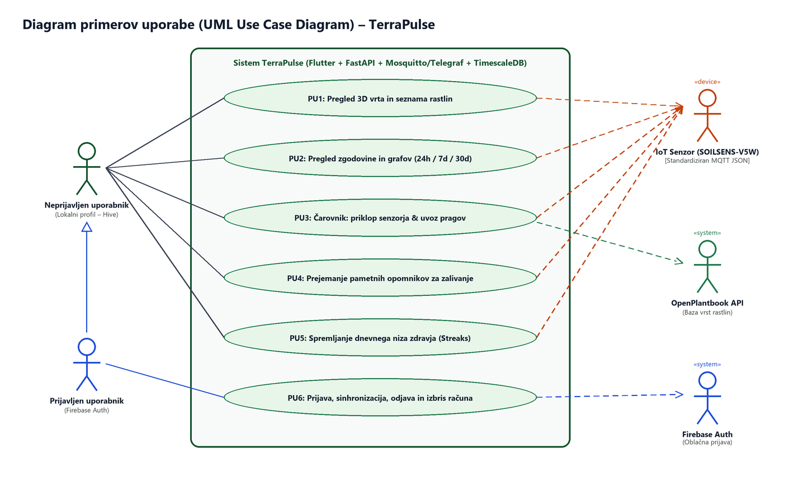
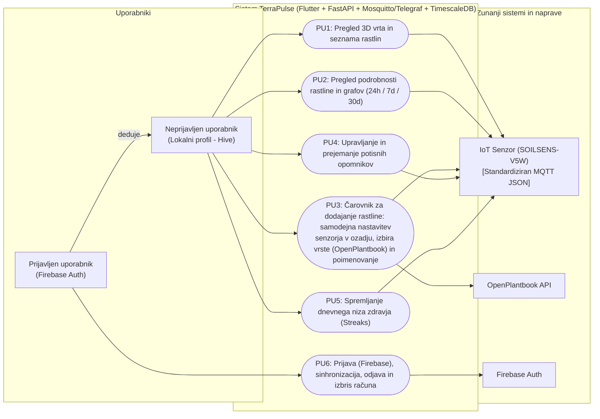

# 2. Diagram primerov uporabe in ključni uporabniški scenariji

> **Predmet:** Razvoj vseprisotnih informacijskih rešitev (RVIR · 2026/2027), FERI, Univerza v Mariboru  
> **Projekt:** TerraPulse – Pametni sistem za spremljanje rasti in zdravja rastlin  
> **Člani ekipe:**  
> * **Luka Grobelnik (Vodja projekta)**  
> * **Jan Mrkonjič**  
> * **Matija Gusel**  

---

## 2.1 Akterji v sistemu
1. **Neprijavljen uporabnik (Lokalni profil – Hive):** Primarni akter, ki uporablja aplikacijo brez obvezne registracije. Ima dostop do 3D vrta, seznama rastlin, podrobnosti in grafov, čarovnika za dodajanje senzorja in rastline, potisnih opomnikov ter nizov (*streaks*).
2. **Prijavljen uporabnik (Firebase Auth):** Nadgrajen uporabnik (deduje vse pravice lokalnega uporabnika), ki je povezal svoj lokalni profil z računom **Firebase Authentication** za varnostno kopiranje v oblaku ter ima možnost odjave in izbrisa računa.
3. **IoT Senzor (npr. SOILSENS-V5W – Standardiziran MQTT JSON):** Poljuben združljiv brezžični senzor, ki po samodejni konfiguraciji v ozadju pošilja standardizirane meritve na **Mosquitto MQTT Broker**, od koder jih **Telegraf** neposredno shranjuje v **TimescaleDB**.
4. **OpenPlantbook API:** Zunanja spletna storitev za iskanje botaničnih vrst in pridobivanje optimalnih življenjskih pragov.
5. **Firebase Authentication:** Zunanja oblačna storitev za prijavo, sinhronizacijo, odjavo in izbris računa.

---

## 2.2 Diagram primerov uporabe (Use Case Diagram)

### Diagram v obliki Mermaid

---

## 2.3 Ključni uporabniški scenariji

### Scenarij 1: Prvi zagon (Prazen vrt) in vodeno dodajanje nove rastline (PU3)
* **Akterji:** Uporabnik (lokalni profil), senzor `SOILSENS-V5W`, OpenPlantbook API, Mosquitto + Telegraf + TimescaleDB.
* **Predpogoji:** Uporabnik prvič odpre aplikacijo (v lokalni bazi Hive še nima nobene rastline).
* **Osnovni tok:**
  1. **Začetni zaslon praznega vrta (*Empty Garden*):** Aplikacija prikaže preprost zaslon *"Your garden is empty"* z gumbom **`+ Add Your First Plant`**, na katerega uporabnik klikne.
  2. **Izbira Wi-Fi omrežja senzorja:** Vodniček uporabnika z ilustracijo gumbov **`CAL` + `TRG`** vodi, da vklopi dostopno točko senzorja in izbere Wi-Fi **`SOILSENS-V5W`**.
  3. **Vnos domačega Wi-Fi omrežja in samodejna konfiguracija v ozadju:** Uporabnik vpiše SSID in geslo domačega Wi-Fi-ja. **Aplikacija sama v ozadju ustvari konfiguracijo** (naslov **Mosquitto MQTT Brokerja**, temo za standardiziran JSON paket in enolični `plant_entity_id`, vezan na uporabnika) ter jo pošlje senzorju.
  4. **Shranjevanje rastline, izbira vrste in poimenovanje:** Za uporabnika se rastlina shrani, uporabnik pa v naslednjem koraku izbere dejansko vrsto rastline prek **OpenPlantbook API** (*Monstera deliciosa*), jo poimenuje (*Living Room Monstera*), izbere prostor (*Living Rm*) in klikne **`Save Plant to Garden`**.
  5. Senzor začne pošiljati standardizirane JSON pakete na **Mosquitto**, od koder jih **Telegraf** samodejno zapisuje v **TimescaleDB**.

---

### Scenarij 2: Pregled 3D Ambientnega vrta in seznama rastlin (PU1, PU4)
* **Akterji:** Uporabnik, FastAPI + TimescaleDB.
* **Predpogoji:** Uporabnik ima v vrtu dodane rastline (npr. *Monstera*, *Ficus*, *Calathea*).
* **Osnovni tok:**
  1. Ob odprtju aplikacije se prikaže **3D Ambientni virtualni vrt**, kjer ambient in rastline vizualno odražajo svoje stanje, zgoraj je prikazan dnevni niz (`14-day streak`), spodaj pa opozorilo *"1 plant needs water • Tap plant to inspect"*.
  2. Uporabnik lahko klikne neposredno na rastlino v 3D vrtu ali preklopi na zavihek **Plants (Seznam rastlin)**, kjer vidi pregledne kartice vseh rastlin (*Living Room Monstera – 98% Healthy*, *Study Ficus – Needs Water • 18%*).

---

### Scenarij 3: Pregled podrobnosti rastline in zgodovinskih grafov (PU2)
* **Akterji:** Uporabnik, FastAPI, TimescaleDB.
* **Predpogoji:** V bazi TimescaleDB Telegraf sproti shranjuje časovne serije meritev.
* **Osnovni tok:**
  1. Uporabnik na seznamu rastlin (ali v 3D vrtu) klikne na *Living Room Monstera*.
  2. Odpre se zaslon **Plant Details**, ki brez prenasičenosti prikaže 4 ključne kartice (`Soil Moisture: 54%`, `Temperature: 22.8°C`, `Air Humidity: 58%`, `Light / DLI: 1,450 lx • 6.4 DLI`) skupaj z optimalnimi razponi iz OpenPlantbooka.
  3. Na grafu **Moisture Trends** uporabnik preklaplja med obdobji **24h**, **7d** in **30d**, ki jih FastAPI bere iz TimescaleDB neprekinjenih agregatov (`plant_metrics_hourly` in `plant_metrics_daily`).

---

### Scenarij 4: Upravljanje profila, oblačne prijave in potisnih obvestil (PU4, PU5, PU6)
* **Akterji:** Uporabnik, Firebase Authentication.
* **Osnovni tok:**
  1. Uporabnik odpre zavihek **Settings**, kjer vidi svojo statistiko (`14 Plants`, `28d Streak`, `98% Vigor Avg`) in status **`Local Profile Active`**.
  2. S stikalom vklopi/izklopi potisna sporočila (*Watering Reminders*, *Daily Streak Notifications*, *Low Sensor Battery Alerts*).
  3. Po želji klikne **`Sign In / Sync with Firebase`** za varnostno kopiranje profila v oblak, ali pa uporabi funkciji **`Log Out`** (odjava) oz. **`Delete Account`** (izbris računa).
