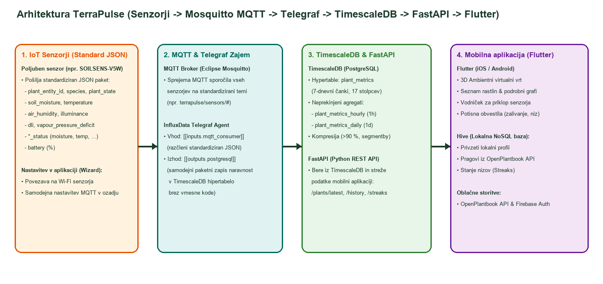
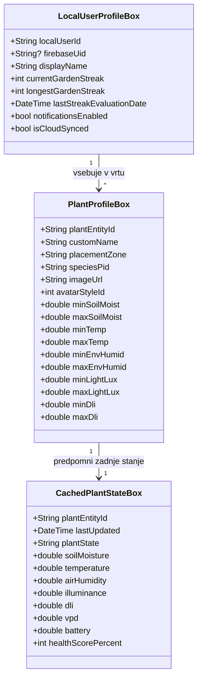

# 4. Začetni podatkovni model, arhitektura in načrtovane tehnologije

> **Predmet:** Razvoj vseprisotnih informacijskih rešitev (RVIR · 2026/2027), FERI, Univerza v Mariboru  
> **Projekt:** TerraPulse – Pametni sistem za spremljanje rasti in zdravja rastlin  
> **Člani ekipe:**  
> * **Luka Grobelnik (Vodja projekta)**  
> * **Jan Mrkonjič**  
> * **Matija Gusel**  

---

## 4.1 Arhitektura sistema TerraPulse

Arhitektura sistema je zasnovana štirislojno in je **strojno neodvisna (*hardware-agnostic*)**: poljuben IoT senzor (kot je referenčni [SOILSENS-V5W](https://github.com/PricelessToolkit/SOILSENS-V5W) ali katerikoli drug senzor na osnovi ESP32/Arduino) pošilja **standardiziran JSON paket** na **Eclipse Mosquitto MQTT Broker**, od koder agent **InfluxData Telegraf** podatke samodejno prebere in neposredno zapiše v časovno-serijsko bazo **TimescaleDB**. Zaledni sistem **FastAPI** podatke in neprekinjene agregate bere iz TimescaleDB ter jih prek REST API-ja streže večplatformski mobilni aplikaciji **Flutter** z lokalno bazo **Hive** ter oblačnima storitvama **OpenPlantbook API** in **Firebase Authentication**.



### Tok podatkov v sistemu (Senzor → Mosquitto → Telegraf → TimescaleDB → FastAPI → Flutter)
1. **IoT sloj (Poljuben senzor s standardiziranim izhodom, npr. `SOILSENS-V5W`):**
   * Ob dodajanju rastline čarovnik v mobilni aplikaciji uporabnika vodi skozi povezavo na Wi-Fi dostopno točko senzorja in vnos domačega Wi-Fi gesla, medtem ko aplikacija v ozadju sama nastavi naslov centralnega **Mosquitto MQTT Brokerja** in senzorju dodeli enolični `plant_entity_id` (npr. `usr_9f8a_s01`).
   * Ker sistem predpisuje **enotno, standardizirano strukturo MQTT JSON sporočila**, lahko v sistem brez spremembe strežniške kode priključimo katerikoli tip senzorja, ki objavlja meritve v tem formatu.
2. **Zajemni sloj (`Eclipse Mosquitto` + `InfluxData Telegraf`):**
   * **Mosquitto MQTT Broker** sprejema sporočila vseh senzorjev na temi `terrapulse/sensors/+`.
   * **Telegraf** je naročen na Mosquitto prek vtičnika `[[inputs.mqtt_consumer]]`, razčleni standardizirani JSON paket in ga prek izhodnega vtičnika `[[outputs.postgresql]]` v paketih (*batches*) zapiše **neposredno v TimescaleDB hipertabelo `plant_metrics`** brez potrebe po vmesni aplikacijski kodi za vpisovanje.
3. **Podatkovni in zaledni sloj (`TimescaleDB` + `FastAPI`):**
   * **TimescaleDB** hrani časovne serije v hipertabeli `plant_metrics`, samodejno osvežuje urne (`plant_metrics_hourly`) in dnevne (`plant_metrics_daily`) neprekinjene agregate ter izvaja stolpično kompresijo.
   * **FastAPI** izvaja optimizirane bralne poizvedbe nad TimescaleDB in mobilni aplikaciji ponuja hitre REST API končne točke (`/plants/latest`, `/plants/{id}/history`, `/plants/{id}/streaks`).
4. **Odjemalski sloj (`Flutter` + `Hive`):**
   * Mobilna aplikacija ob zagonu ustvari privzeti **lokalni profil v bazi Hive**, kamor shrani tudi biološke pragove vrst iz **OpenPlantbook API-ja**, poljubna imena rastlin in stanje uporabniških nizov (*streaks*). Po želji se uporabnik prijavi prek **Firebase Auth** za varnostno kopiranje profila v oblak.

---

## 4.2 Standardizirani format MQTT sporočila in konfiguracija Telegraf

Da lahko v sistem TerraPulse vključimo katerikoli tip rastlinskega senzorja, je definirana standardizirana JSON shema na MQTT temi `terrapulse/sensors/{plant_entity_id}`:

```json
{
  "plant_entity_id": "usr_9f8a_s01",
  "species": "monstera deliciosa",
  "plant_state": "ok",
  "soil_moisture": 54.2,
  "temperature": 22.8,
  "air_humidity": 58.0,
  "illuminance": 1450.0,
  "dli": 6.4,
  "vapour_pressure_deficit": 0.92,
  "moisture_status": "ok",
  "temperature_status": "ok",
  "illuminance_status": "ok",
  "humidity_status": "ok",
  "dli_status": "ok",
  "vpd_status": "ok",
  "battery": 94.0
}
```

### Konfiguracija Telegraf agenta (`telegraf.conf`) za neposreden zapis v TimescaleDB

```toml
# Vhodni vtičnik: bere standardizirana JSON sporočila iz Mosquitto MQTT Brokerja
[[inputs.mqtt_consumer]]
  servers = ["tcp://mosquitto:1883"]
  topics = ["terrapulse/sensors/+"]
  qos = 1
  data_format = "json_v2"

  [[inputs.mqtt_consumer.json_v2]]
    measurement_name = "plant_metrics"
    [[inputs.mqtt_consumer.json_v2.tag]]
      path = "plant_entity_id"
    [[inputs.mqtt_consumer.json_v2.field]]
      path = "species"
      type = "string"
    [[inputs.mqtt_consumer.json_v2.field]]
      path = "plant_state"
      type = "string"
    [[inputs.mqtt_consumer.json_v2.field]]
      path = "soil_moisture"
      type = "float"
    [[inputs.mqtt_consumer.json_v2.field]]
      path = "temperature"
      type = "float"
    [[inputs.mqtt_consumer.json_v2.field]]
      path = "air_humidity"
      type = "float"
    [[inputs.mqtt_consumer.json_v2.field]]
      path = "illuminance"
      type = "float"
    [[inputs.mqtt_consumer.json_v2.field]]
      path = "dli"
      type = "float"
    [[inputs.mqtt_consumer.json_v2.field]]
      path = "vapour_pressure_deficit"
      type = "float"
    [[inputs.mqtt_consumer.json_v2.field]]
      path = "moisture_status"
      type = "string"
    [[inputs.mqtt_consumer.json_v2.field]]
      path = "temperature_status"
      type = "string"
    [[inputs.mqtt_consumer.json_v2.field]]
      path = "illuminance_status"
      type = "string"
    [[inputs.mqtt_consumer.json_v2.field]]
      path = "humidity_status"
      type = "string"
    [[inputs.mqtt_consumer.json_v2.field]]
      path = "dli_status"
      type = "string"
    [[inputs.mqtt_consumer.json_v2.field]]
      path = "vpd_status"
      type = "string"
    [[inputs.mqtt_consumer.json_v2.field]]
      path = "battery"
      type = "float"

# Izhodni vtičnik: neposreden zapis v TimescaleDB hipertabelo plant_metrics
[[outputs.postgresql]]
  connection = "host=timescaledb user=postgres password=${DB_PASS} dbname=terrapulse sslmode=disable"
  tags_as_foreign_keys = false
```

---

## 4.3 Časovno-serijski podatkovni model v TimescaleDB

Osrednja tabela v podatkovni bazi **TimescaleDB** (razširitev za PostgreSQL) je hipertabela `plant_metrics`, razdeljena (*partitioned*) po časovnem stolpcu `time`.

### Struktura hipertabele `plant_metrics`

| Stolpec | Podatkovni tip | Opis | Primer vrednosti |
| :--- | :--- | :--- | :--- |
| `time` | `TIMESTAMPTZ NOT NULL` | Časovni žig meritve (primarni ključ delitve v čanke) | `2026-11-10 11:30:00+01` |
| `plant_entity_id` | `TEXT NOT NULL` | Enolični identifikator senzorja/rastline, ki ga dodeli aplikacija | `usr_9f8a_s01` |
| `species` | `TEXT` | Botanično ime vrste rastline (povezava z OpenPlantbook) | `monstera deliciosa` |
| `plant_state` | `TEXT` | Skupno stanje rastline (`ok`, `problem`, `unavailable`) | `ok` |
| `soil_moisture` | `DOUBLE PRECISION` | Vlažnost prsti v odstotkih (`%`) | `54.2` |
| `temperature` | `DOUBLE PRECISION` | Temperatura prsti/okolice v stopinjah Celzija (`°C`) | `22.8` |
| `air_humidity` | `DOUBLE PRECISION` | Relativna vlažnost zraka v odstotkih (`%`) | `58.0` |
| `illuminance` | `DOUBLE PRECISION` | Trenutna osvetljenost v luksih (`lx`) | `1450.0` |
| `dli` | `DOUBLE PRECISION` | Dnevni svetlobni integral ($\text{mol/m}^2\text{/dan}$) | `6.4` |
| `vapour_pressure_deficit` | `DOUBLE PRECISION` | Primanjkljaj parnega tlaka – VPD (`kPa`) | `0.92` |
| `moisture_status` | `TEXT` | Status vlažnosti prsti (`ok`, `low`, `high`) | `ok` |
| `temperature_status` | `TEXT` | Status temperature (`ok`, `low`, `high`) | `ok` |
| `illuminance_status` | `TEXT` | Status osvetljenosti (`ok`, `low`, `high`) | `ok` |
| `humidity_status` | `TEXT` | Status vlažnosti zraka (`ok`, `low`, `high`) | `ok` |
| `dli_status` | `TEXT` | Status dnevnega svetlobnega integrala (`ok`, `low`, `high`) | `ok` |
| `vpd_status` | `TEXT` | Status primanjkljaja parnega tlaka (`ok`, `low`, `high`) | `ok` |
| `battery` | `DOUBLE PRECISION` | Nivo napolnjenosti baterije senzorja (`%`) | `94.0` |

### SQL DDL za ustvarjanje hipertabele in indeksov

```sql
CREATE TABLE plant_metrics (
    time TIMESTAMPTZ NOT NULL,
    plant_entity_id TEXT NOT NULL,
    species TEXT,
    plant_state TEXT,
    soil_moisture DOUBLE PRECISION,
    temperature DOUBLE PRECISION,
    air_humidity DOUBLE PRECISION,
    illuminance DOUBLE PRECISION,
    dli DOUBLE PRECISION,
    vapour_pressure_deficit DOUBLE PRECISION,
    moisture_status TEXT,
    temperature_status TEXT,
    illuminance_status TEXT,
    humidity_status TEXT,
    dli_status TEXT,
    vpd_status TEXT,
    battery DOUBLE PRECISION
);

-- Pretvorba v TimescaleDB hipertabelo s 7-dnevnim intervalom čankov (chunks)
SELECT create_hypertable(
    'plant_metrics',
    by_range('time', INTERVAL '7 days')
);

-- Sestavljeni indeks za najpogostejše poizvedbe po posamezni rastlini in času
CREATE INDEX idx_plant_metrics_entity_time
    ON plant_metrics (plant_entity_id, time DESC);
```

---

## 4.4 Analiza najpogostejših poizvedb (*Most Frequent Queries*)

Pri delovanju mobilne aplikacije **TerraPulse** in zalednega sistema **FastAPI** se izvajajo štiri glavne skupine poizvedb:

### 1. Poizvedba za 3D Virtualni vrt in Seznam rastlin (Zadnje stanje uporabnikovih rastlin)
* **Pogostost:** Zelo visoka (ob vsakem odprtju aplikacije ali osvežitvi vrta).
* **Namen:** Pridobiti zadnjo izmerjeno vrstico za vsak uporabnikov `plant_entity_id`, da lahko 3D vrt in seznam rastlin takoj prikažeta stanje (`plant_state`, `moisture_status`, `illuminance`, `battery`).
* **Optimizirana poizvedba (`DISTINCT ON` z uporabo indeksa `(plant_entity_id, time DESC)`):**
```sql
SELECT DISTINCT ON (plant_entity_id)
    plant_entity_id, time, species, plant_state,
    soil_moisture, temperature, air_humidity, illuminance,
    dli, vapour_pressure_deficit,
    moisture_status, temperature_status, illuminance_status,
    humidity_status, dli_status, vpd_status, battery
FROM plant_metrics
WHERE plant_entity_id = ANY(:user_plant_ids)
  AND time > NOW() - INTERVAL '24 hours'
ORDER BY plant_entity_id, time DESC;
```

### 2. Poizvedba za zgodovinske grafe (24 ur, 7 dni, 30 dni)
* **Pogostost:** Visoka (vsakič, ko uporabnik odpre podrobnosti rastline ali preklopi časovno okno).
* **Namen:** Izris gladkih časovnih grafov za `soil_moisture`, `temperature`, `air_humidity`, `illuminance`, `dli` in `vapour_pressure_deficit`.
* **Optimizacija:** Namesto branja surovih točk iz hipertabele `plant_metrics` aplikacija bere že vnaprej izračunane **neprekinjene agregate** (`plant_metrics_hourly` za 24h/7d in `plant_metrics_daily` za 30d+).

### 3. Poizvedba za izračun in preverjanje nizov (*Streaks*)
* **Pogostost:** Srednja (ob zagonu aplikacije in ob dnevnem preverjanju).
* **Namen:** Ugotoviti, koliko zaporednih preteklih dni je bila rastlina v optimalnem stanju (delež meritev v dnevu, kjer je `plant_state = 'ok'`, presega 90 %).
* **Optimizacija:** Izvaja se neposredno nad dnevnim neprekinjenim agregatom `plant_metrics_daily`.

### 4. Poizvedba za proženje potisnih opomnikov (Zalivanje in baterija)
* **Pogostost:** Periodična preverba zadnjih zapisov v TimescaleDB prek FastAPI.
* **Namen:** Sprožiti potisno obvestilo ob prehodu v `moisture_status = 'low'` ali `battery < 15`.

---

## 4.5 Neprekinjeni agregati (*Continuous Aggregates*)

Za zagotavljanje pod-milisekundnega odziva pri izrisu grafov in izračunu nizov (*streaks*) uporabimo **TimescaleDB Continuous Aggregates**, ki v ozadju samodejno in inkrementalno materializirajo podatke.

### 1. Urni neprekinjeni agregat (`plant_metrics_hourly`)
Uporablja se za grafe **zadnjih 24 ur** (24 točk) in **zadnjih 7 dni** (168 točk).

```sql
CREATE MATERIALIZED VIEW plant_metrics_hourly
WITH (timescaledb.continuous) AS
SELECT
    time_bucket('1 hour', time) AS bucket,
    plant_entity_id,
    LAST(species, time) AS species,
    AVG(soil_moisture) AS avg_soil_moisture,
    MIN(soil_moisture) AS min_soil_moisture,
    MAX(soil_moisture) AS max_soil_moisture,
    AVG(temperature) AS avg_temperature,
    MIN(temperature) AS min_temperature,
    MAX(temperature) AS max_temperature,
    AVG(air_humidity) AS avg_air_humidity,
    AVG(illuminance) AS avg_illuminance,
    MAX(dli) AS max_dli,
    AVG(vapour_pressure_deficit) AS avg_vpd,
    LAST(battery, time) AS last_battery,
    COUNT(*) AS total_samples,
    COUNT(*) FILTER (WHERE plant_state = 'ok') AS ok_samples,
    COUNT(*) FILTER (WHERE moisture_status = 'low') AS low_moisture_samples
FROM plant_metrics
GROUP BY bucket, plant_entity_id
WITH NO DATA;

-- Politika samodejnega osveževanja vsakih 15 minut
SELECT add_continuous_aggregate_policy('plant_metrics_hourly',
    start_offset => INTERVAL '3 hours',
    end_offset   => INTERVAL '5 minutes',
    schedule_interval => INTERVAL '15 minutes');
```

### 2. Dnevni neprekinjeni agregat (`plant_metrics_daily`)
Uporablja se za **30-dnevne / letne grafe** ter za **hiter izračun dnevnih nizov zdravja (*Streaks*)**:
* Ker se dnevni svetlobni integral (`dli`) čez dan akumulira, v dnevnem agregatu vzamemo `MAX(dli)` kot končni dnevni DLI.
* Razmerje `ok_samples::FLOAT / total_samples` nam takoj pove dnevni odstotek zdravja rastline brez branja surovih vrstic.

```sql
CREATE MATERIALIZED VIEW plant_metrics_daily
WITH (timescaledb.continuous) AS
SELECT
    time_bucket('1 day', time) AS day_bucket,
    plant_entity_id,
    LAST(species, time) AS species,
    AVG(soil_moisture) AS avg_soil_moisture,
    MIN(soil_moisture) AS min_soil_moisture,
    MAX(soil_moisture) AS max_soil_moisture,
    AVG(temperature) AS avg_temperature,
    MIN(temperature) AS min_temperature,
    MAX(temperature) AS max_temperature,
    AVG(air_humidity) AS avg_air_humidity,
    AVG(illuminance) AS avg_illuminance,
    MAX(dli) AS daily_dli,
    AVG(vapour_pressure_deficit) AS avg_vpd,
    MIN(battery) AS min_battery,
    COUNT(*) AS total_samples,
    COUNT(*) FILTER (WHERE plant_state = 'ok') AS ok_samples,
    COUNT(*) FILTER (WHERE moisture_status != 'ok') AS moisture_violation_samples
FROM plant_metrics
GROUP BY day_bucket, plant_entity_id
WITH NO DATA;

-- Politika samodejnega osveževanja vsako uro
SELECT add_continuous_aggregate_policy('plant_metrics_daily',
    start_offset => INTERVAL '3 days',
    end_offset   => INTERVAL '1 hour',
    schedule_interval => INTERVAL '1 hour');
```

---

## 4.6 Politike kompresije in hrambe podatkov (*Compression & Retention Policies*)

Časovno-serijski podatki senzorjev vsebujejo veliko ponavljajočih se nizov (`species`, `plant_state`, `moisture_status`, `temperature_status`, `illuminance_status`, `humidity_status`, `dli_status`, `vpd_status`) in počasi spreminjajočih se številskih vrednosti (`DOUBLE PRECISION`). Z uporabo stolpične kompresije (**TimescaleDB Columnar Compression**) zmanjšamo porabo prostora na disku za **90–95 %** in hkrati pohitrimo analitične poizvedbe.

### Izbira parametrov kompresije
1. **`timescaledb.compress_segmentby = 'plant_entity_id'`**:
   * Vse poizvedbe v aplikaciji TerraPulse filtrirajo podatke po posamezni rastlini (`WHERE plant_entity_id = ...`). Segmentiranje po `plant_entity_id` zagotovi, da so podatki iste rastline stisnjeni skupaj v istih stolpičnih blokih, zato poizvedba prebere le segmente izbrane rastline.
2. **`timescaledb.compress_orderby = 'time DESC'`**:
   * Mobilna aplikacija vedno najprej zahteva najnovejše podatke in nato potuje nazaj v zgodovino. Urejenost po `time DESC` omogoča izjemno hitro branje brez dodatnega razvrščanja.
3. **Algoritmi kompresije po tipih stolpcev:**
   * `time`: *Delta-of-delta* kodiranje (ker so intervali meritev skoraj konstantni, se časovni žigi stisnejo na nekaj bitov).
   * `soil_moisture`, `temperature`, `air_humidity`, `illuminance`, `dli`, `vapour_pressure_deficit`, `battery`: *Gorilla XOR* kompresija za plavajočo vejico.
   * `species`, `plant_state` in vseh 6 `*_status` stolpcev: *Dictionary + Run-Length Encoding (RLE)*, saj imajo le 3 možne vrednosti (`ok`, `low`, `high`) in se redko spreminjajo.

### SQL konfiguracija kompresije in hrambe (Retention)

```sql
-- 1. Vklop kompresije na surovi hipertabeli plant_metrics
ALTER TABLE plant_metrics SET (
    timescaledb.compress,
    timescaledb.compress_segmentby = 'plant_entity_id',
    timescaledb.compress_orderby = 'time DESC'
);

-- Samodejna kompresija surovih podatkov, starejših od 7 dni
SELECT add_compression_policy('plant_metrics', INTERVAL '7 days');

-- 2. Vklop kompresije na urnem neprekinjenem agregatu (starejši od 30 dni)
ALTER MATERIALIZED VIEW plant_metrics_hourly SET (
    timescaledb.compress = true
);
SELECT add_compression_policy('plant_metrics_hourly', INTERVAL '30 days');

-- 3. Politika hrambe (Retention Policy):
-- Surove meritve hranimo 90 dni, urne agregate 1 leto, dnevne agregate pa trajno
SELECT add_retention_policy('plant_metrics', INTERVAL '90 days');
SELECT add_retention_policy('plant_metrics_hourly', INTERVAL '365 days');
```

---

## 4.7 Lokalni podatkovni model na napravi (Flutter Hive)

Za delovanje brez obvezne prijave (*offline-first*), shranjevanje OpenPlantbook pragov in sledenje nizom aplikacija na napravi uporablja tri **Hive Box** shrambe:



---

## 4.8 Povzetek načrtovanih tehnologij

| Sloj | Tehnologija | Vloga v projektu TerraPulse |
| :--- | :--- | :--- |
| **Mobilno ogrodje** | **Flutter (Dart)** | Večplatformski razvoj aplikacije za Android in iOS ter čarovnik za samodejno konfiguracijo senzorja. |
| **3D / Interaktivni vrt** | **Flutter 3D / Rive / Lottie** | 3D ambientni virtualni vrt, ki se odziva na `plant_state`, `moisture_status` in `illuminance`. |
| **Lokalna shramba** | **Hive** | Hitra NoSQL baza na napravi za lokalni profil, poimenovanja rastlin, OpenPlantbook pragove in predpomnilnik. |
| **Avtentikacija** | **Firebase Authentication** | Opcijska oblačna prijava (Google / E-pošta) za varnostno kopiranje lokalnega profila, odjavo in izbris računa. |
| **Zunanja baza rastlin** | **OpenPlantbook API** | Pridobivanje bioloških pragov (`min`/`max` vlaga, temperatura, svetloba) za posamezno vrsto (`species`). |
| **Zaledni sistem (Backend)** | **FastAPI (Python)** | REST API za branje časovnih serij in agregatov iz TimescaleDB ter streženje podatkov mobilni aplikaciji. |
| **Zajem MQTT podatkov** | **Eclipse Mosquitto + Telegraf** | Sprejem standardiziranih JSON paketov poljubnih senzorjev prek MQTT in samodejni zapis v TimescaleDB. |
| **Časovno-serijska baza** | **TimescaleDB (PostgreSQL)** | Shranjevanje senzorskih meritev, neprekinjeni agregati (`1h`, `1d`) in stolpična kompresija. |
| **IoT senzorji** | **SOILSENS-V5W (ali poljuben senzor)** | Pošiljanje standardiziranih meritev (prst, zrak, svetloba, baterija) prek protokola MQTT. |
| **Verzioniranje in CI/CD** | **GitHub & GitHub Actions** | Vodenje nalog (Issues, Pull Requests), samodejno testiranje, statična analiza (`flutter analyze`) in gradnja. |
